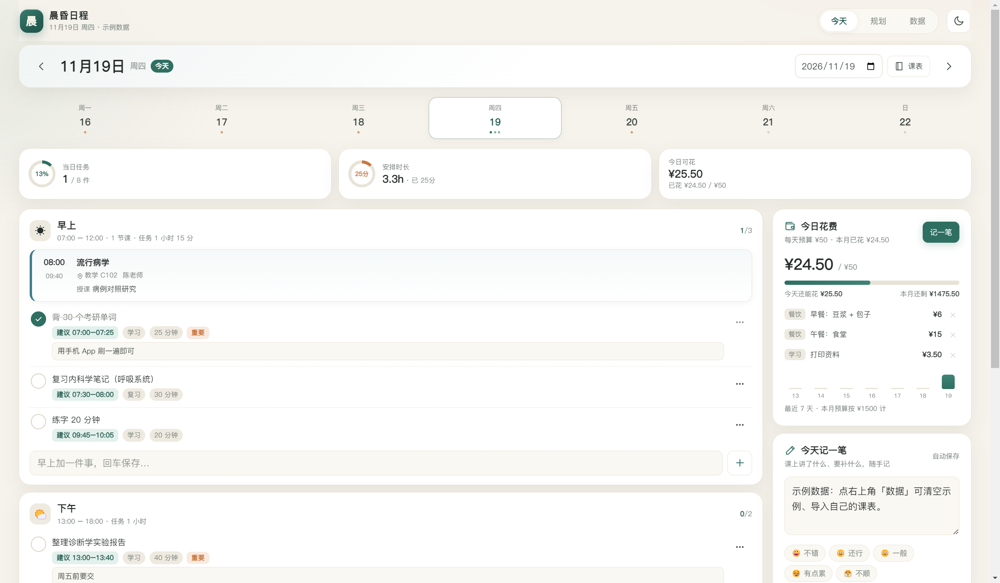
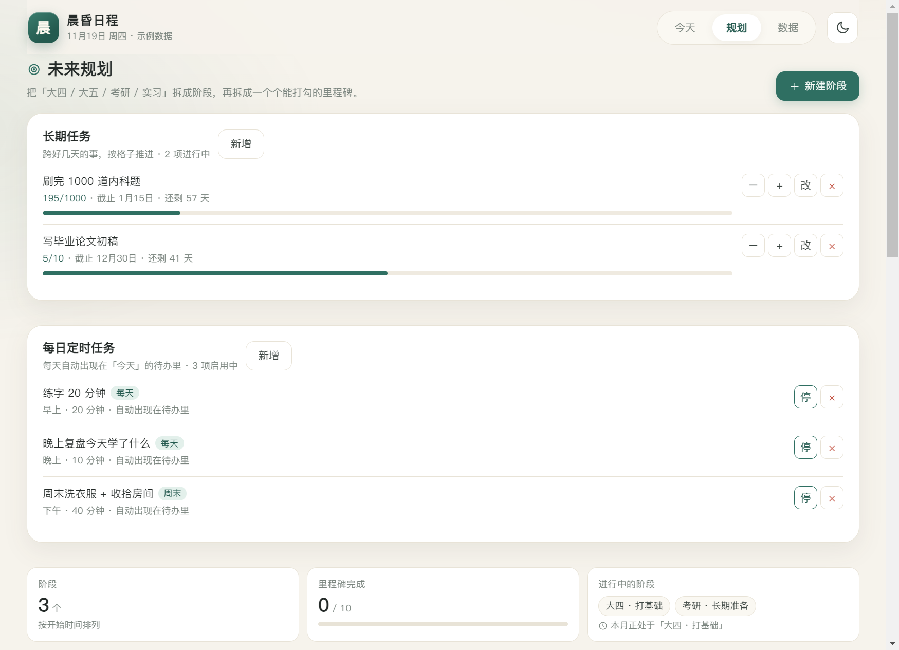
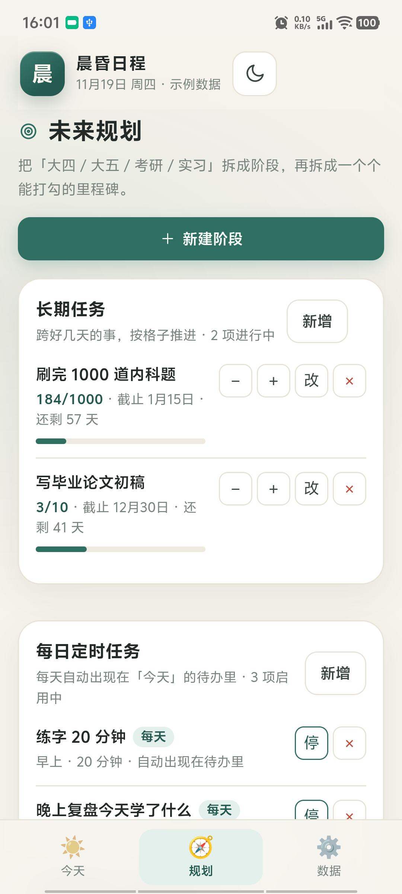
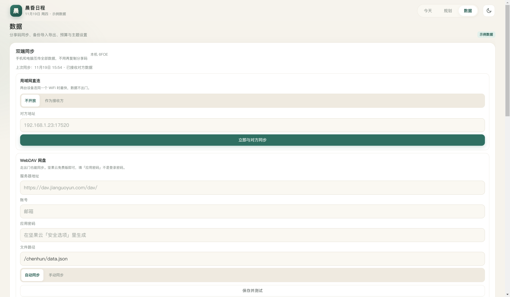
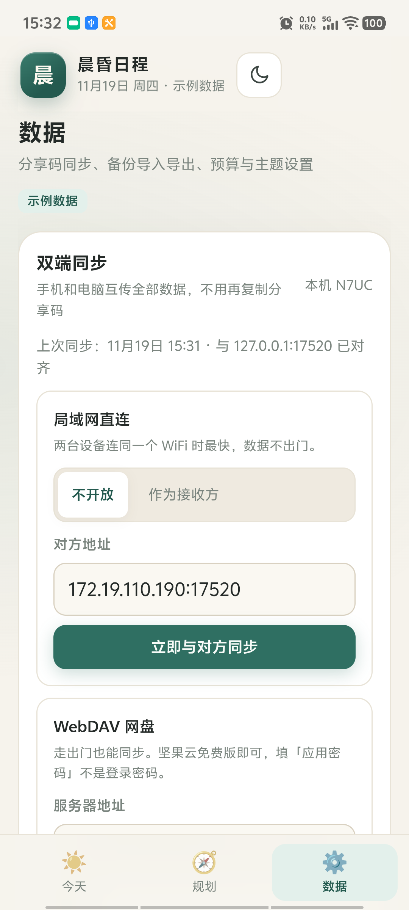

# 晨昏日程 · Chenhun Planner

每天的学习、课程、任务与省钱计划，加上大四 / 大五 / 考研的长期规划。
**手机和电脑双端，数据本地保存，可自动互相同步。**

打包成 Windows 桌面程序和安卓 App，不再依赖浏览器打开。



---

## 这是什么

原本是一个单文件 HTML 日程应用（约 190KB，零外部依赖）。这个仓库把它包成两个真正的应用：

| 平台 | 产物 | 体积 |
|---|---|---|
| Windows | `ChenhunPlanner-1.0.0-portable.exe`（免安装，双击即用） | 约 71 MB |
| Android | `ChenhunPlanner-1.0.apk`（minSdk 23 / targetSdk 34） | 约 105 KB |

并且在原应用之上补了一层**同步内核**，让两端不用再靠复制粘贴分享码。

## 功能

**日程本体**（沿用原应用）

- 早 / 午 / 晚三段式任务，带预计用时、优先级、推荐完成时间
- 固定课程表 + 当天临时加课，自动排进时间段
- 每日开销记录、月预算、可花余额
- 大四 / 大五 / 考研 / 实习的长期规划与里程碑
- 深色模式、JSON 备份导入导出、分享码

**这次新增**

- 桌面端 + 安卓端，图标、窗口、底部导航都是原生手感；宽屏铺满，不再两侧留白
- **长期任务**：跨多天推进的目标，按"格子"记录进度，带截止日期与进度条（如「写毕业论文 5/10」）
- **每日定时任务**：每天 / 工作日 / 周末自动出现在当天待办里的固定事项，勾选与用时统计沿用原有逻辑
- **局域网直连同步**：两台设备同一个 WiFi，输入对方地址即对齐
- **WebDAV 自动同步**：接坚果云等网盘，出门也能同步
- **三向合并**：以「上次同步的结果」为基线，逐字段判断该保留哪一边，不会互相覆盖
- 删除不会被另一端的旧数据复活；冲突时保留内容而不是丢弃







## 安装

**Windows**（两种，任选）

- `ChenhunPlanner-1.0.0-portable.exe`：单文件，双击即用，不写注册表。首次运行 Windows 需要解压到临时目录，若被杀软拦下会一闪而过。
- `ChenhunPlanner-1.0.0-win-x64.zip`：**推荐**。解压到任意目录，双击 `ChenhunPlanner.exe` 即可，不经过临时目录，最不容易被拦。

数据存在 `%APPDATA%\晨昏日程`，两种方式通用。

**Android**：下载 `ChenhunPlanner-1.0.apk`，安装时允许「未知来源」。数据存在应用私有目录，覆盖升级不会丢。

> 首次运行 Windows 版时系统可能弹出防火墙提示，允许后局域网同步才能被手机连上。

## 怎么同步

### 方式一：局域网（推荐，数据不出门）

1. 两台设备连同一个 WiFi
2. 电脑打开「数据」页 → 局域网直连 → 选「作为接收方」
3. 页面上会显示本机地址，例如 `192.168.1.23:17520`
4. 手机「数据」页填入这个地址 → 点「立即与对方同步」

电脑端会在收到数据后立刻更新，不需要手动再点一次。

### 方式二：WebDAV（跨公网）

以坚果云为例：

1. 登录坚果云网页版 → 账户设置 → 安全选项 → 添加应用密码
2. 在任意一端填：服务器地址 `https://dav.jianguoyun.com/dav/`、账号（邮箱）、应用密码
3. 文件路径保持 `/chenhun/data.json`
4. 点「保存并测试」，成功后另一台填同样的配置

开启「自动同步」后，每次改动约 12 秒后自动推一次。

### 同步是怎么保证不丢数据的

- 每次同步后把合并结果记成**基线**（`chenxi.sync.base`）
- 下次同步时逐字段三向比较：`基线 / 本机 / 对端`
  - 只有一边改过 → 用改过的
  - 两边都改 → 保留本机，并计入「冲突 N 处」
  - 一边删除、另一边没动 → 尊重删除
  - 一边删除、另一边改过 → 保留内容（宁可多一条，也不丢字）
- 第一次同步没有基线，走**并集合并**：两边独有的内容全部并进来，冲突字段优先保留有内容的一侧

## 从源码构建

需要 Node.js 22+，Windows 打包还需要能访问 npm 镜像。

```bash
# 桌面端
cd desktop
npm install
npx electron-builder --win portable     # 产物在 dist/desktop/

# 安卓端（不需要 Android Studio / Gradle）
python tools/unpack_sdk.py              # 首次：缺什么下什么（JDK 17 + build-tools + platform，约 300MB）
bash tools/build_apk.sh                 # 产物在 dist/android/
```

安卓端是手写构建链：`aapt2` 编译资源 → `javac` 编译 → `d8` 转 dex → `zipalign` → `apksigner` 签名。

`unpack_sdk.py` 可反复执行：已就绪的会跳过，缺的自动从 Adoptium / Google 下载，也支持先把压缩包放进 `dl/` 再离线解压。
工具链不随仓库分发（`tools/jdk`、`tools/android-sdk` 已在 `.gitignore` 里）。

## 目录结构

```
common/     两端共用的页面与同步内核（唯一一份合并逻辑）
desktop/    Electron 主进程、预加载脚本、打包配置
android/    原生 WebView 壳（Java）+ 清单 + 资源
tools/      HTML 注入、图标生成、SDK 解压、APK 构建、调试脚本
docs/       截图
```

关键设计：**合并逻辑只在 `common/sync-core.js` 里写一份**，两端共用。
外壳只负责三件事——发 HTTP、当局域网中转、提供平台信息。

## 已知限制

- **局域网同步要求两台设备在同一个 WiFi 且没有被客户端隔离。** 校园网、公共热点常开启 AP 隔离，此时互相 ping 不通，走 WebDAV 更稳。
- 安卓端作为「接收方」时靠轮询发现新数据（约 3 秒），桌面端是主进程推送，几乎即时。
- 桌面端未做代码签名，SmartScreen 首次可能提示「未知发布者」，选「仍要运行」。
- 安卓签名证书 `android/chx.keystore` 随仓库一起提交（口令 `chenhun2026`），仅用于自签名 sideload。**不要用它发布到应用商店**；如需上架请更换并妥善保管。
- 桌面端构建产物内的 exe 名为 `ChenhunPlanner.exe`（ASCII）。窗口标题与界面仍是「晨昏日程」——中文 exe 名会让 NSIS 便携壳在启动时失败。

## 许可

MIT
